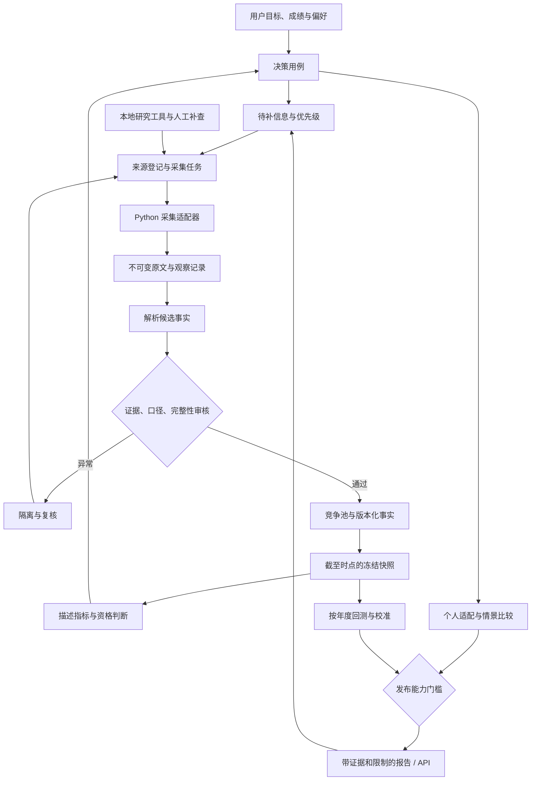

# GradHeat 架构 v0.2

> 2026-09-23 选型补充：当前优先完成采集方案评审与样本验证，业务编码暂缓。[详细评审](ARCHITECTURE-REVIEW-2026-09-23.md)明确：先交付离线报告，Java API 不是前置；首池沿用 requests/lxml，多站点常态采集优先评估 Scrapy，是否使用 JS 与是否采用爬虫框架是两项独立决策。

2026-09-22。本文件是当前架构入口，替代 [v0.1 归档](archive/DESIGN-v0.1.md)。旧文档中的三年周期、录取分布转概率、来源权重转置信度及旧路线图均不作为实现依据。详细理由见 [决策审查](DECISION-REVIEW.md)。

## 1. 产品目标与范围

帮助考生在明确年度、报考阶段、硬约束、成绩不确定性和个人偏好的前提下，比较少量可解释的院校专业选择。每个结论能回到原始证据，每次比较能按当时版本复现。

第一版交付资格筛选、历史门槛与结果描述、复试规则比较、名额变化、个人适配和情景敏感性。热度是补充信号；概率与行为博弈模型经验证后才升级发布。最小范围为 1 校 1 个完整竞争池，随后扩至 3 校 6—10 个池。当前清单不代表所有 11408 项目；同卷不消除年度、阅卷、自选择和复试差异。

## 2. 当前状态与模块边界

| 模块 | 当前实物 | 目标与责任 |
|---|---|---|
| 采集 | Python requests/lxml；院校清单、入口探测、JSONL、MySQL 导入 | Python 拥有采集、解析、指标与模型；先统一脚本边界 |
| 研究 | Exa、Firecrawl、Scite、领域技能 | 人工研究和疑难补查，不成为线上请求的隐式依赖 |
| 持久化 | MySQL、证据文件；已有基础 SQL | MySQL 管理任务、事实版本和发布；文件保存不可变原文 |
| 缓存/队列 | Redis、RabbitMQ 已部署 | Redis 只缓存；按任务量启用队列，不当作唯一任务账本 |
| 治理/决策 | 研究规范与审查文档 | 竞争池、字段证据、冻结快照、情景与概率模型尚待实现 |
| API/页面 | 尚无 Spring Boot/Vue 应用 | 模块化单体；Java 管查询/用户/审核/发布，Vue 管比较与解释 |
| 发布契约 | 本轮新增清单、校验器与离线样例 | 最低保护层，尚未接入生产采集或 API |

Python 与 Java 共享版本化契约，不各自实现一套指标公式。API 读取持久分析结果，不现场搜索或训练。不新增重型调度平台；仅在吞吐、隔离或独立发布确有需求时拆服务。

## 3. 端到端架构

不同学校独立推进。采集失败重抓，解析失败重放已有原文，指标失败重算固定快照；下游失败不得反写上游事实。低完整度对象局部降级，不能阻断全部候选。

## 4. 数据契约与版本

| 对象 | 标识/粒度 | 约束 |
|---|---|---|
| source | source_id，发布机构与入口 | 域名只是线索，必须确认主体；记录抓取策略和最后成功时间 |
| acquisition_run | run_id，一次限定范围采集 | 年度、预期/实得条数、错误类别、代码版本和 attempt |
| artifact / observation | 原文 SHA-256 / 观察事件 ID | 原始字节不可变；相同内容可多次观察；哈希不含采集时间 |
| extraction | extraction_id | 原文、解析器版本、页码/表格定位、候选值；LLM 不直接产已审核事实 |
| competition_pool / member | pool_id + version / 年度成员关系 | 按官方实际排名录取池，可跨专业方向；未知映射不自动合并 |
| fact_revision | fact_id + revision | 值、单位、池/年度、发布时间、证据与审核；更正追加版本 |
| rule / capacity_revision | 池 + 年度 + revision | 单科、资格、复试换算、名额和推免口径，不覆盖历史 |
| outcome_record | 池 + 年度 + 内部标识 | 入围/录取阶段分开；限制身份数据，页面只公开汇总 |
| snapshot | snapshot_id | cutoff、事实版本清单、口径版本与清单哈希；冻结后不可变 |
| analysis_run / release | run_id / release_id | 快照、代码/模型版本、参数/随机种子、质量门槛与替代关系 |

使用带时区 ISO 8601，存储统一 UTC，页面北京时间展示。招生年度、发布时间、适用期和系统记录时间分开。未知不填零或 false，不同培养方式、专项、一志愿/调剂不得混池。

在线历史回放仅使用当时已记录的信息。现在采到的旧公告只能作明确标记的历史重建，需有原始发布时间及版本证据，不能冒充在线快照。计划数、推免数、实际统考数分别留版本。

现有 school/program 等表暂作兼容查询层，审核后的事实再更新当前投影。不把旧 URL 字段自动提升成字段级证据。新迁移独立编号、先演练；不改写 `001_schema.sql` 为破坏性重建。

## 5. 发布能力与模型边界

多平台热度作为独立信号支路，覆盖小红书、抖音、B站、知乎；详见 [HEAT-SIGNALS.md](HEAT-SIGNALS.md)。先分别展示内容供给、互动、意向表达和传播集中度，平台间不直接相加，未验证增量预测价值前不进入录取概率。

学习研究采集底座首轮选择 MediaCrawler，以独立 worker 经适配层输出内容观察快照；小红书 xhs、抖音 F2 作为专项对照候选，已关停的 Nemo2011/bilibili-api 不作为新依赖。按平台验收后启用，不将上游支持列表视为稳定性证明。详细边界见 [SOCIAL-COLLECTOR-SELECTION.md](SOCIAL-COLLECTOR-SELECTION.md)。

| 能力 | 必需条件 | 不满足时 |
|---|---|---|
| descriptive | 池一致；关键事实有原文、定位、审核；快照有效 | 展示缺失，不推断资格通过 |
| scenario | 上述条件 + 显式参数、偏好、敏感性与反转条件 | 退回描述比较；情景数值不叫概率 |
| probability | 上述条件 + 标签群体、两阶段定义、时间外验证、校准及适用范围审核 | 禁止概率发布，不用录取者 CDF 替代 |

完整度、证据等级、模型不确定性分别展示。资格返回 pass/fail/unknown；unknown 不进入“已满足资格”集合。冲突先隔离，对相关结论局部阻断，不能用均值调和。

指标固定分母、样本量、分位数方法和缺失处理。录取者分布仅描述被录取群体。机会估计拆分入围概率与入围后录取条件概率，审查样本选择偏差。个人成绩含分科范围及相关性假设，不随意假定独立。

博弈先做容量、需求和个人发挥情景；没有依据不赋情景概率。均衡存在不意味着可预测，三年交替不证明周期。热度变量须证明相对简单基线的样本外增量；规则、行为反馈与相关性分开解释。

## 6. 任务可靠性与发布

初期同步 CLI 按 manifest 执行，MySQL 记录任务。需要并发时采用已有 RabbitMQ：业务数据与 outbox 同事务；发布 confirm 后记已发送；消费按 task_id + 输入版本 + 处理器版本幂等，提交后 ACK。允许重发，不允许重复结果，不宣称 exactly-once。

429 按 Retry-After 延后，网络错误有限退避，401 停止并报配置问题，解析变化进入复核；死信不无限回灌。任务租约、attempt、next_retry_at 持久化。生产确认不能替代消费确认，依据见 [RabbitMQ 可靠性指南](https://www.rabbitmq.com/docs/reliability)。

发布通过原子“当前版本”指针切换；失败继续服务上个可用版本并显示时间。原文变更只标记依赖结果 stale，经审核重算后再发布。回滚切回旧 release_id，保留旧报告和原因。

## 7. 查询与用户流程

拟定接口（尚未实现）：`GET /v1/pools`、`GET /v1/pools/{id}?snapshot_id=...`、`POST /v1/comparisons`、`GET /v1/comparisons/{id}`、`GET /v1/evidence/{id}`。

比较输入包含年度、阶段、cutoff、候选池、硬约束、成绩范围和偏好；响应包含 release_id、能力级别、资格状态、理由、证据、缺失及情景。内部模型和基础设施细节不进入普通考生流程。

用户流程为“目标与限制 → 候选资格 → 证据与规则 → 个人匹配 → 情景与偏好 → 保存快照”。多个候选不等于可同时报考的组合；调剂须单独建模并核对当年规则。展示哪条待查信息可能改变选择，以此生成补查任务。

## 8. 运维与落地

服务健康与数据健康分别监测：成功率/限流、数量变化、缺失/冲突、证据定位率、积压、快照年龄、校准。阈值按源和池配置，不给全部学校套同一数量阈值。

文件持久写入后才提交其数据库引用；孤立文件可后续核对，数据库不得指向不存在的原文。证据与数据库协同备份；目标为日备份、7 日每日及 4 周每周保留，并在独立环境恢复演练。这是待落实验收项，不是已有备份承诺。日志不含密钥或完整身份信息。

验证顺序：契约/失败路径 → 固定原文回放 → 1 池人工核对 → 迁移与幂等演练 → 报告追踪 → 时间外评估。工作包见 [WORKFLOW.md](WORKFLOW.md)，最低机器契约见 [contracts/README.md](../contracts/README.md)。研究标准和工具状态分别见 [证据规范](RESEARCH-EVIDENCE-POLICY.md)、[搜索配置](SEARCH-SETUP.md)。
