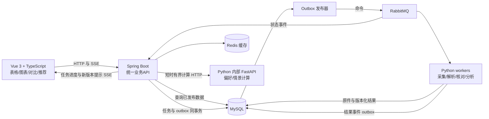

# GradHeat 正式架构方案与现状核对

2026-10-09。正式方向：Vue 3/TypeScript 前端、Spring Boot 业务主服务、Python 采集与分析服务、RabbitMQ 任务通道、MySQL 权威存储、Redis 可恢复缓存。这是接下来的实现方案，不代表 Java/消息业务链已经上线。

## 1. 当前到底实现了什么

| 部分 | 核对结果 |
|---|---|
| 用户页面 | `workbench/static/`，原生HTML/CSS/JavaScript；没有Vue/React工程 |
| 实际API | `workbench/gradheat_workbench/app.py`，FastAPI；本地入口18728当前离线 |
| Spring Boot | 老架构中的候选；本仓库没有Java源码、pom.xml或Gradle工程 |
| Python | 官网/GitHub/四平台采集、原件存储、信息一致核对、数据投影、个人比较与情景计算已实现 |
| MySQL/Redis | 已真实存储与读回复验；Redis可以从MySQL投影恢复 |
| RabbitMQ | 2026-10-09T14:24:22Z，VM192.168.43.132上`gradheat-rabbitmq`健康，镜像3.13；`/gradheat`队列列表为空、连接列表为空 |
| Java—Python业务消息 | 没有生产者、消费者或outbox实现；没有端到端验收 |
| 每日任务 | 现为Codex每日09:00自动化及Python脚本，没有Java调度器 |

只读核查原件：`.research/architecture-review-20261009/runtime-check.json`。RabbitMQ设施存在不能称为消息业务接入成功。近期FastAPI工作台是在原Java候选方案之外实现的过渡产品，这个区别应明确说明。

## 2. 服务边界



第一阶段使用一个模块化Spring Boot应用与一组Python进程。各Python worker共享代码包而按任务类型部署；浏览器worker留在Windows，本机登录资料不转移到VM。图中HTTP与RabbitMQ分工分别是即时请求和异步任务，不在两种语言各实现一套数学公式。

### 前端

采用Vue 3单文件组件、TypeScript、Vite；比较清单/偏好使用集中状态管理；图表拟用ECharts。组件至少划分`AdmissionsTable`、`ColumnFilter`、`InstitutionCharts`、`CompareBoard`、`HeatPanel`、`PreferenceForm`、`GameScenario`、`TaskStatus`。

固定表头、六列窄屏完整显示、每列搜索/选值/排序作为迁移验收条件。本轮已经把密集四按钮改成列名加单一入口；展开才显示搜索、选值、默认/升序/降序，生效状态留在表头。窄屏全局条件默认折叠。普通页面只接收纯数据投影，来源留在后台原件及审核工具。

### Java主服务

负责统一API、用户与权限、院校查询、比较保存/导出、任务创建与状态、审核流程、版本发布管理、SSE通知。学院/专业/年度/方式/专项的筛选与查询必须保留原口径。

建议JDK21与Spring Boot4.1.1作为新工程验证起点，Maven依赖由Boot BOM管理；Spring AMQP连接RabbitMQ，Spring JDBC访问现有公开投影与业务表。当前系统Java23不等于项目已配置JDK21。框架版本与依赖兼容、受支持中间件版本在真正建工程时固定并记录，不本轮升级现有数据库或RabbitMQ。

### Python数据与算法

负责公共页面/文档采集、共享MediaCrawler适配、PDF/图片解析、候选事实提取、语义同事项识别、独立来源链核对、社交样本聚合、描述指标、偏好和博弈算法。FastAPI缩为内部计算/健康接口，采集由独立worker执行。

已有字段入库与核对管线直接复用。LLM候选不是一致票；跨年/院系/专业/专项/方式/人群的结果不混用。至少两条独立来源链一致取消相应信息待核，官方反值与官方未匹配说明单独保存。

## 3. 消息通道具体怎样联合Java与Python

推荐RabbitMQ AMQP 0-9-1 + UTF-8 JSON。Java用Spring AMQP；Python客户端由单worker连接模型决定，先验证Pika常驻消费者。消息只带任务、版本、范围和原件SHA引用，不带PDF正文、视频、Cookie、签名或浏览器账户资料。

拟定两个exchange：`gradheat.commands`投递工作，`gradheat.events`广播持久化状态。至少分离以下队列：

| 工作队列 | Python处理器 | 关键边界 |
|---|---|---|
| `collect.official` | 官网/GitHub采集 | 按来源域限速、固定commit、增量原件 |
| `collect.social.win-primary` | Windows浏览器worker | 仅消费绑定该浏览器的任务；并发1、prefetch1、查询间隔至少30秒、详情3秒 |
| `extract.documents` | PDF/表格/图片解析 | 读取已经入库的原件，不重新下载 |
| `verify.information` | 来源归属与语义核对 | 同源转载一票、未知不填零、保留冲突 |
| `analyse.long` | 热度聚合/较长情景计算 | 独立计算预算和输入快照 |

这些名字为方案；当前RabbitMQ没有创建这些队列。即时查询直接由Java读取MySQL/Redis，已有轻量偏好和有界博弈请求可经Java调用Python内部HTTP。超过同步预算的计算返回202及task_id，再走异步通道。页面请求不会触发全网爬取。

示例命令：

```json
{
  "schema_version": 1,
  "message_id": "唯一消息ID",
  "task_id": "唯一任务ID",
  "type": "collect.official",
  "input_version": "已冻结输入SHA",
  "processor_version": "collector-v1",
  "scope": {"unit": "南京大学", "cohort": 2027, "subjects": ["101", "201", "301", "408"]},
  "trace_id": "全链路ID",
  "attempt": 1,
  "created_at": "带UTC时区的时间",
  "deadline_at": "带UTC时区的截止时间"
}
```

正式契约还要限制类型、长度、范围和worker归属。重发维持原message_id及逻辑任务幂等键；真正新attempt有独立记录，不覆盖旧失败。事件含result_id、结果SHA、采集/计算状态、缺失项，Java从MySQL读取结果；RabbitMQ不作为结果数据库。

## 4. 一次更新的事务与恢复

1. Java在同一MySQL事务写入`task`与`outbox`，提交后将task_id返回页面。
2. 发布器投RabbitMQ，开启publisher confirms及mandatory/未路由回报；只有队列接收确认且无未路由返回才标outbox已发送。
3. Python领取任务，用`task_id + input_version + processor_version`形成幂等执行记录和任务租约。已有成功结果则复用，不重抓。
4. 原件字节、SHA、候选/结果和结果事件outbox提交完成后才ACK。结果事件由独立发布器投递，不先通知后入库。
5. Java消费事件，按message_id唯一inbox去重，在事务中更新任务状态；再ACK，并向在线页面发送SSE。页面断线后读取MySQL任务状态补齐，SSE不作唯一记录。

数据库提交后、ACK前崩溃会导致消息重投；幂等键防止重复产物。outbox确认回包丢失也可能重复投递。这里采用“至少一次投递＋业务幂等”，不承诺exactly-once。

普通暂时网络错误有限退避；解析异常隔离、无法处理进入死信/人工复核。验证码先持久化`paused_human`、发状态事件、ACK，避免自动重投不断触发验证。只有用户明确完成才生成受控恢复attempt。原件存储续传独立于采集重试，不清平台暂停。

任务账本包含状态、attempt、lease/heartbeat、next_retry_at、deadline、worker_id和失败原因。排队、采集、入库、核验、发布分别记录；入库成功不等于信息已核验。取消或输入版本过期的结果保留历史，但不切换当前发布头。

## 5. 存储和单一写入责任

| 内容 | 存储 | 目标写入方 |
|---|---|---|
| 原始HTML/PDF/图片等字节、版本、来源定位 | 现有MySQL material/chunk、research/social表 | Python |
| 提取候选、审核记录、同事项核对、模型结果 | MySQL追加记录 | Python产候选/核对/结果；Java审核动作独立表 |
| 用户、比较/偏好记录、任务、inbox/outbox | MySQL业务表 | 各服务只写自己拥有的业务行 |
| 不可变公开资料版本 | MySQL admissions_publication | Python生成 |
| 当前发布头及审核放行 | MySQL admissions_head | 切换阶段确定唯一发布者；目标Java协调CAS切换 |
| 查询、热度和可重算结果缓存 | Redis | 版本＋查询/参数哈希键，TTL；丢失后从MySQL重建 |
| 运行中消息 | RabbitMQ | 两端生产/消费；长期任务与结果仍在MySQL |

目前发布头由Python既有发布脚本维护；Java接管之前保持这个单一责任。迁移时使用expected_current_version的比较交换，不让旧worker把当前头退回旧版。Python和Java不双写同一业务状态或各自改表结构。原件仍按用户要求存MySQL字节，本地研究目录为工作副本。

## 6. 页面、推荐、热度与模型

Java提供`/api/v1/admissions`、`/admissions/comparisons`、`/recommendations`、`/heat`、`/game-scenario`、`/dashboard`和`/tasks/{id}`，完整路径以`contracts/application-v1/README.md`为准。Python内部接口仅供业务服务；旧`/api/*`为FastAPI过渡接口，前端生产构建只请求Java的`/api/v1`。

用户现在没有成绩：按2027年11408、专业/方向、学位/方式硬筛，按用户填写的专业及资料类别偏好排序。“985/计算机强校/研究所”现有分组不自动当实力榜；双非友好没有充分证据则待核，不以同等学力限制或初试权重推断。

热度显示各平台去重样本、公开互动、真实查询/排序及实际采样时间。定时刷新库内结果不等于全站实时采集，跨平台不相加成报名人数。博弈为假设容量与需求的情景；既有势函数检查不能替代真实录取概率的校准。

## 7. 部署与实施顺序

VM192.168.43.132：MySQL、Redis、RabbitMQ和目标Java服务。Python普通HTTP/解析/计算进程可部署VM；登录Chrome与社交worker留Windows。两侧通过已有严格验证SSH/内网连接，不转移浏览器会话。单VM没有高可用承诺，备份恢复及受支持RabbitMQ升级应独立验收。

先固定OpenAPI与JSON消息契约；再搭Vue组件化和Java只读查询/比较保存；随后做一个Java→RabbitMQ→Python→MySQL→RabbitMQ→Java的真实小任务。必须验证重复消息、提交后ACK前退出、断网与验证码暂停。成功后再移交每日调度、全部采集与较长分析。

每日09:00只保留一个权威调度器。切换到Java前继续现有自动化；正式切换时停旧定时任务，并核对没有活跃冻结批次。现有原件、历史判定和个人比较版本全部按增量方式复用；不运行清空建库脚本。Vue、Java与Python模块已分别编码和测试，009新增表已增量应用；实际消息联合验收及持续部署以实施计划的单独状态为准。

## 8. 官方依据及证据级别

- Vue单文件组件适用于有构建步骤的复杂前端：[官方组件说明](https://vuejs.org/guide/scaling-up/sfc.html)。Vite与ECharts参考[构建说明](https://vite.dev/guide/)及[图表入门](https://echarts.apache.org/handbook/en/get-started/)。实际固定版本与构建检查见frontend模块说明。
- Boot4.1.1文档列Java17—26及Maven3.6.3+范围：[官方系统要求](https://docs.spring.io/spring-boot/system-requirements.html)。目标工程还须检验选定第三方依赖；没有用预览版本。
- Java消息发送/接收由[Spring AMQP](https://docs.spring.io/spring-amqp/reference/amqp.html)提供。Pika选型须在建立Python常驻消费者时按实际连接/线程模型验证。
- ACK与publisher confirm解决不同阶段、允许重投与重复处理：[RabbitMQ确认说明](https://www.rabbitmq.com/docs/confirms)、[可靠性指南](https://www.rabbitmq.com/docs/reliability)。阅读的是当前4.3文档，不把它当现有3.13部署已经验证所有特性；outbox/inbox及职责边界是本项目方案。
