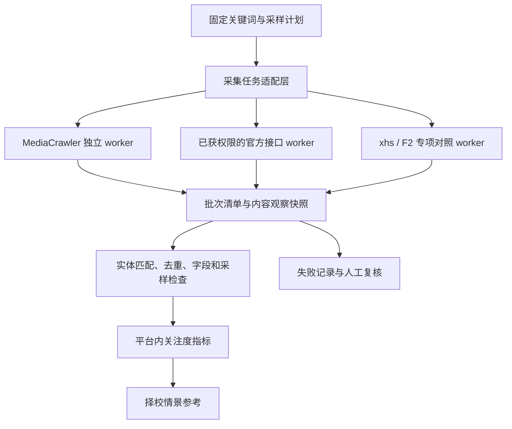

# 社交平台采集项目选型：学习研究用途

核验日期：2026-09-23。用户已明确本项目用于学习研究，以实际可靠性优先。此次完成仓库、许可证、文档、部分代码入口与问题记录核查；尚未安装或登录平台运行，不宣称采集已经稳定。

## 选型决定

**MediaCrawler 作为四平台统一采集的首轮试点底座**，使用独立进程/环境接入。按平台分别验收，某平台失败不阻断其他平台。现阶段不另外维护四套完整爬虫，也不因为非商业学习限制排除符合本项目用途的候选。

| 项目 | 已核验信息 | 在本项目中的角色 |
|---|---|---|
| [NanmiCoder/MediaCrawler](https://github.com/NanmiCoder/MediaCrawler) | 非归档；文档列出小红书、抖音、B站、知乎的关键词、详情、作者和评论能力；代码搜索确认知乎 search 入口 | 首选试点，统一适配层；各功能是否真实可用仍分项验收 |
| [ReaJason/xhs](https://github.com/ReaJason/xhs) | 非归档；MIT；代码含 get_note_by_keyword，README 提示实际接入更复杂 | 小红书专项对照与备用研究对象；尚无证据证明比 MediaCrawler 更稳 |
| [Johnserf-Seed/f2](https://github.com/Johnserf-Seed/f2) | 非归档；Apache-2.0；面向作品下载及接口数据处理；找到抖音用户主页内搜索示例 | 抖音详情/已知作者路线的对照候选；不能将 TikTok 搜索或主页内搜索等同于抖音全站搜索 |
| [Nemo2011/bilibili-api](https://github.com/Nemo2011/bilibili-api) | 当前归档；README 声明停止维护并永久关停 | 排除新依赖。旧教程、旧包和 star 数不能改变当前维护事实 |

MediaCrawler 的[许可证](https://github.com/NanmiCoder/MediaCrawler/blob/main/LICENSE)允许非商业学习研究，并限制大规模采集；本项目采取小规模样本验证，不以此限制阻断方案研究。xhs 与 F2 的许可证分别在其仓库 [LICENSE](https://github.com/ReaJason/xhs/blob/master/LICENSE)、[LICENSE](https://github.com/Johnserf-Seed/f2/blob/main/LICENSE)核对。软件许可证不提供接口持续可用保证。

“非归档”只是最低维护信号，不等于近期高频维护。本次没有完整审计所有提交、发行包及问题修复周期，因此不按维护活跃度虚构精确排名。

## 已知不确定性

- MediaCrawler [#866](https://github.com/NanmiCoder/MediaCrawler/issues/866)报告小红书评论回复返回 406；[#796](https://github.com/NanmiCoder/MediaCrawler/issues/796)反映按知乎问题获取全部回答的能力缺口。这些是用户问题报告，不是本机复现，也不能证明当前所有版本仍有同样问题。
- F2 [#443](https://github.com/Johnserf-Seed/f2/issues/443)报告抖音特定分页访问返回 403；该场景不等于关键词搜索。用于提醒分页和访问状态需独立验收。
- 具备搜索函数不证明返回完整、排序一致或时间过滤生效。不能把“支持评论”理解为可取得全部历史评论和回复。
- 多个项目可能依赖相同的平台接口机制，因此换一个库不必然构成独立可用的降级路径。

## 接入架构

主项目不导入第三方爬虫内部业务表，不把其结构当稳定契约。通过 `search(query, window, budget)`、`fetch_detail(content_ids)`、`observe_metrics(content_ids)` 三类任务接收导出的标准记录；这些是规划边界，不是已实现接口。

统一记录：platform、content_id、source_url、published_at、observed_at、query_version、排序与时间过滤参数、采样上下文、metrics、raw_artifact、upstream_version、parser_version、run_id。metrics 中不可见字段为 null；不把点赞、播放、收藏混成同一个数。

分页批次额外记录 requested_budget、returned_count、cursor、has_more、truncated、stop_reason。结果状态区分 ok/partial/empty/auth_required/rate_limited/schema_changed/failed。只有确认正常查询无结果才记 empty；登录过期或响应异常不能写零热度。

每个平台独立凭据、超时、资源预算与停止开关。凭据不进入结果或仓库；观察到登录失效、挑战页或访问拒绝时保存失败状态并暂停相关任务，供人工处理。原始文档和适配输出分开留存。

先采标题、链接、发布时间与可见互动统计；评论仅抽取小样本用于意向分类，不默认展开二级回复，不下载整批视频。这样将资源集中在择校信号而非无关媒体存储。

任何平台 API 或逆向适配层变化都不得阻断官方招生采集。热度缺失时报告显示缺失，保留官方事实驱动的比较能力。

## 如何选出真正可靠的路线

1. 安装前选定具体提交/版本，核对许可证与依赖，保存版本清单；本轮未锁定可运行版本。
2. 四个平台各取相同 3—5 个院校/专业查询，限定结果预算；人工标注相关性、发布时间、互动字段和分页状态。
3. 至少在不同日期重复三轮，区分一次成功、可重复成功及持续稳定。无匹配结果使用人工确认有内容的对照查询，避免将空样本误判为成功。
4. 对已知内容 ID 重访，验证统计快照；对失败、字段变更和截断验证能否正确降级。
5. 按平台比较有效任务率、字段正确性、重复率、人工干预时间、请求/浏览器耗时及内存。样本内所有发布所需关键字段必须核对，错误记录隔离；不虚构全站覆盖率。
6. MediaCrawler 某平台达标即保留；不达标时才用专项库做同样本对照。备用若不更好，退回官方接口或人工样本，不为“支持四平台”强行运行。

这一试点只证明采集路径可用。热度的年度预测价值仍按 [HEAT-SIGNALS.md](HEAT-SIGNALS.md) 独立检验，不随采集成功自动获得。
