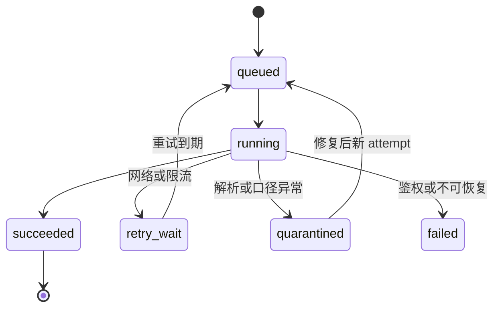

# 执行流程与验收

与 [架构 v0.2](DESIGN.md) 配套。本轮交付架构、流程和最低发布清单校验器；下列业务模块仍须逐项实现。

## 1. 单个竞争池的闭环

| 阶段 | 产物 | 责任 | 放行条件 |
|---|---|---|---|
| 定义问题 | 年度、阶段、约束、候选与待查清单 | 产品/研究 | 范围明确，不冒充全量 |
| 来源登记 | 发布主体、入口、文档类型与频率 | 采集维护 | 主体确认，失败策略明确 |
| 采集 | 原文/附件、哈希、观察事件 | 采集器 | 有效正文持久化，空/失败分开 |
| 解析 | 带定位的候选事实 | 解析器 | 年份、单位、池、分母明确 |
| 审核 | accepted/rejected/conflicted | 研究审核 | 关键数字回看原文，LLM 不自提取自放行 |
| 冻结 | 不可变 snapshot | 数据用例 | 截止时间与依赖版本检查通过 |
| 描述/筛选 | 指标和资格状态 | 分析模块 | unknown 不当 pass，公式与证据可追溯 |
| 情景比较 | 偏好与风险取舍 | 决策模块 | 假设显式，给出反转条件 |
| 发布 | release 与验收记录 | 发布审核 | 能力门槛通过，旧版本保留 |
| 更新 | stale 标记与复核任务 | 更新用例 | 只重算受影响结果，复核后切换 |

一人可兼任角色，但审核动作必须单独记录。全链共用 run_id/trace_id，记录版本而非私人数据。

## 2. 状态与恢复

任务成功不等于事实审核成功。事实状态单独保存；发布为 draft → validated → published → superseded，撤销保留 revoked 和原因。旧 attempt 不改写为成功；解析更新重放原文，来源更新新建 artifact，更正追加 revision。

## 3. 工作包与完成定义

| 顺序 | 工作包 | 依赖 | 验收产物 |
|---|---|---|---|
| P0.1 | 修复入口探测及批次失败 | 无 | best=None 不崩溃；tried 与探测时间留存；身份/用途硬条件；单校失败不中断整批 |
| P0.2 | 快照与证据追加 | P0.1 | 原文/事实哈希与运行元数据分开；同秒不覆盖；probe 不删除历史；状态可降级 |
| P0.3 | 导入门槛 | P0.2 | 数量异常隔离；失败日志独立留存；未知科目不写 false |
| P1.1 | 竞争池、规则、证据及版本迁移 | P0 | 独立迁移和兼容读取；中位数支持小数；不同录取阶段不混池 |
| P1.2 | 1 校 1 池样本 | P1.1 | 目录/名额/规则/入围/结果按可得性采集，缺失降级，逐字段复核报告 |
| P1.3 | 描述报告闭环 | P1.2 | 来源 → 原文 → 事实 → 快照 → 指标 → 比较可追溯 |
| P2.1 | 3 校 6—10 池情景 | P1.3 | 覆盖规则变化、缺失、冲突；成绩/偏好变化能解释差异 |
| P2.2 | API 与页面 | P1.3 | 只读已发布结果；unknown 可见；报告可重现，证据访问受控 |
| P3.1 | 基线与模型准入 | P2.1 | 数据冻结、标签/训练时点、逐年误差/校准/适用范围；不达标维持描述级 |
| P3.2 | 扩覆盖及队列 | 稳定闭环和任务量依据 | 重复投递不重复结果；恢复演练通过；坏数据不替换已发布版本 |

P0 来自 [代码审查](DECISION-REVIEW.md#8-代码层已确认的问题与修复次序)，本轮没有将历史问题标为已修复。服务部署不等于业务验收。

每份报告必须有目标年度、阶段、cutoff、候选集范围、池版本、资格原因、关键事实定位、样本量、缺失和计算方法。情景与偏好可复算；概率限制在验证范围内。保存快照与发布清单，并指出最值得补查的信息。

## 4. 时间验证与故障演练

在线回放要求 observed_at 与 published_at 均不晚于 cutoff。历史重建允许 observed_at 较晚，但需原发布时间证据并标记 reconstructed，不与 live_snapshot 混用。训练只能使用测试截止前已知的标签；同池同年随机拆分不算跨年检验。

验收演练包含：重复执行、单源超时、200 但正文无效、关键字段缺失、推免口径未知、事实冲突、未来信息注入、数据库提交后 ACK 前崩溃，以及公告变更导致旧结果 stale。先离线 fixture，数据库/队列在对应阶段实现后演练。

部署按“备份 → 独立环境迁移/回放 → 数据核对 → 小范围运行 → 发布指针切换”。回滚优先切应用版本与 release，数据库前向修复；不能用旧备份直接覆盖后续新增事实。恢复演练记录耗时和丢失范围后，再设可承诺的 RPO/RTO。
